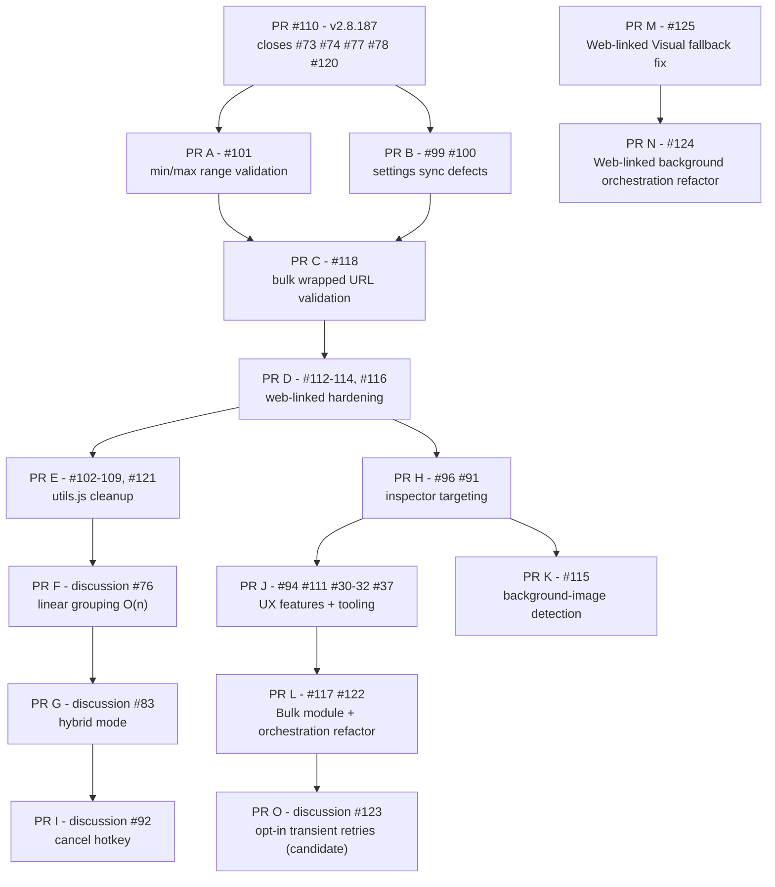

# 🏔️ Mass Image Downloader – Release Roadmap

**Project:** Mass Image Downloader (Chrome MV3, open source, MPL 2.0)</br>
**Repository:** github.com/del-Pacifico/Mass-Image-Downloader</br>
**Maintainer:** Sergio Palma Hidalgo ([@sergiopalmah](https://github.com/sergiopalmah))</br>
**Contributors:** Mr. [@agentsmid](https://github.com/agentsmid)</br>
**Status:** Proposed — pending maintainer approval</br>
**Standards:** This document follows the [Contributing Guide](CONTRIBUTING.md), including the Documentation Standards, Markdown Format, Development Flow, and Labeling Rules sections.</br>
**Last updated:** 2026-11-13

---

## 🧭 1. Purpose

This document is the single source of truth for planned releases. It orders all open
work — from most urgent to least urgent — into versioned release trains, each backed
by one or more pull requests with explicit scope, dependencies, and QA gates.

It complements, and does not replace:

- [CHANGELOG.md](../CHANGELOG.md) — what **shipped**
- [GitHub Issues](https://github.com/del-Pacifico/Mass-Image-Downloader/issues) — what is **tracked**
- [GitHub Discussions](https://github.com/del-Pacifico/Mass-Image-Downloader/discussions) — what is **explored**

### How to read this document

- Each release lists the PRs it ships and the issues/discussions each PR closes.
- Items are ordered by **urgency**, not by estimated effort.
- An item only moves **down** the list through maintainer decision, never sideways.
- Branch naming follows `<type>/<issue>-<slug>` (for example, `fix/101-minmax-range-validation`).
- Commits follow Conventional Commits: `<type>(<scope>): description (#issue)`.
- Every PR must pass local validation before review:

```bash
npm run check
npm test
```

- Manual QA runs on **Brave** (primary), plus Vivaldi, Edge, and Opera One.
- Bugfix PRs are scoped to one confirmed defect class only. Refactors ship separately.

---

## 📋 2. Release overview

| Release | PR(s) | Theme | Closes |
|---|---|---|---|
| **v2.8.187** | PR #110 (existing) | Pending release batch | #73, #74, #77, #78, #120 |
| **v2.8.188** | PR A, PR B, PR C | Config & settings hotfixes | #99, #100, #101, #118 |
| **v2.8.189** | PR D, PR E, PR F, PR G | Web-linked Gallery epic | #102–#109, #112–#114, #116, #121, discussions #76, #83, #90|
| **v2.8.190** | PR H, PR I, PR J, PR K, PR L | Inspector targeting, UX features, tooling | #30–#32, #37, #91, #94, #96, #111, #115, #117, #122, discussion #92 |
| **v2.8.191** | PR M, PR N, PR O (candidates) | Web-linked fallback/orchestration & Bulk resiliency | #125, #124, discussion #123 (pending approval) |

Housekeeping (label pass, stale discussion closures, announcements) is scheduled in
[Section 8](#🏷️-8-meta--housekeeping) and does not require a code release.

<details>
<summary><strong>Dependency graph (supplementary — same information as the table)</strong></summary>



</details>

---

## 🚢 3. v2.8.187 — Pending release batch

**Source:** existing PR [#110](https://github.com/del-Pacifico/Mass-Image-Downloader/pull/110)
**Status:** QA-approved; awaiting maintainer merge (assigned to @sergiopalmah)

### Closes

| Item | Summary |
|---|---|
| #73 | Web-linked gallery: numeric hotfix for sequential asset naming (`00.html`–`14.html`) |
| #74 | One-click scoring: multi-factor anti-ad penalties |
| #77 | Inspector icon floating after open-in-new-tab |
| #78 | One-click IIFE guard + toast sequence hardening |
| #120|Added `docs/quick-start.md`: comprehensive step-by-step guide for non-technical users, covering installation, first download workflow, and common issues. Linked from root `README.md` and Documentation Hub (`docs/README.md`).|

### Rationale

This is the operational gate for everything below. The fixes have been QA-approved
since September; the branch is stable, and merging unblocks:

- the anti-ad filter from #74 — a stated **precondition** for the Hybrid mode feature
  (discussion #83);
- the release of v2.8.187, which ships the #77 fix already marked
  `status: ready-for-release` / `status: qa-approved`.

### Post-merge verification (mandatory)

- Re-test the #77 fix on the Inspector flow in Brave.
- Verify **#96** (regression candidate): the spatial fallback introduced by the #77 fix
  must not mount overlays over thumbnails occluded by a site lightbox (ArtStation).

---

## 🚑 4. v2.8.188 — Config & settings hotfixes

Three PRs addressing configuration and validation defects. Shipped together as one
hotfix release because all affect how user settings are validated and applied at runtime.

### PR A — `fix/101-minmax-range-validation`

**Closes:** [#101](https://github.com/del-Pacifico/Mass-Image-Downloader/issues/101)

**Why first:** the only open issue labeled `priority: high`. `initConfigCache()` in
`utils.js` parses `minWidth`/`minHeight` with no range validation, and
`isConfigCacheValueUsable()` only checks `> 0`. Corrupted storage values (`NaN`,
`-5`, `999999`) propagate to **every** extraction flow (Bulk, Direct Links, Visual,
Web-Linked, Inspector). The correct pattern already exists in `imageInspector.js`
(range 1–10000 with fallback to defaults) — the fix replicates it in `utils.js`.

**Scope discipline:** ships alone. Minimal diff, clean blame, trivially cherry-pickable.

**QA:** corrupt storage via DevTools (`minWidth: "abc"`, `minHeight: -5`,
`minWidth: 999999`) and confirm fallback to 800×600 across all five flows.

### PR B — `fix/99-100-settings-sync-defects`

**Closes:** [#99](https://github.com/del-Pacifico/Mass-Image-Downloader/issues/99),
[#100](https://github.com/del-Pacifico/Mass-Image-Downloader/issues/100)

**Why second:** same module, same defect class, one review cycle:

- **#99 — High business impact, trivial fix:** `options.js` references
  `document.getElementById("downloadLimit")`, which does not exist in `options.html`.
  The `|| 1` fallback silently nulls download concurrency on every settings save,
  defeating the Performance Presets. For a mass-download extension this degrades the
  core product. Fix: add the missing input bound to the existing `downloadLimit` key.
- **#100:** the `storage.onChanged` listener in `utils.js` does not handle the six
  format flags (`allowJPG`/`allowPNG`/`allowWEBP`/`allowAVIF`/`allowBMP`/`allowGIF`),
  so format toggles take up to 60 s to apply. Fix: add the six branches following the
  pattern already used for other keys.

**QA:** change formats and download limit in Options; confirm immediate effect in a
live extraction without reload; confirm presets actually parallelize.

### PR C — `fix/118-bulk-wrapped-url-validation`

**Closes:** [#118](https://github.com/del-Pacifico/Mass-Image-Downloader/issues/118)

**Why:** Bulk Image Download rejects all tabs with Reddit wrapped-media URLs
(`reddit.com/media?url=<encoded_image_url>`) even when `allowWrappedImageUrls` is
enabled. The validation function `isDirectImageUrl()` in `utils.js` does not implement
URL unwrapping logic, despite CHANGELOG v2.8.185 explicitly promising that "Bulk Image
Download, One-click Download Icon, and manual download now normalize supported image
URLs consistently, including wrapped variants." This is a regression of a promised
behavior that blocks core functionality (0 downloads from valid tabs).

**Root cause confirmed via code inspection:**

1. `handleBulkDownload()` in `background.js` calls `isDirectImageUrl(urlForValidation)`
   where `urlForValidation` is the raw `tab.url` (the wrapped URL).
2. `isDirectImageUrl()` in `utils.js` only checks if the URL pathname or query string
   contains a valid image extension. It does NOT detect wrapped-URL patterns, extract
   the inner URL, or consult `configCache.allowWrappedImageUrls`.
3. For wrapped URLs like `reddit.com/media?url=https%3A%2F%2Fi.redd.it%2F[image_id].jpg`,
   the pathname is `/media` (no extension) and `lastSegment` is `media` (not `.jpg`),
   so validation fails.
4. The option `allowWrappedImageUrls` exists in `configCache` and is correctly read
   from storage, but `isDirectImageUrl()` never queries it.

**Scope:**

1. Modify `isDirectImageUrl()` in `utils.js` to:
   - Check if `configCache.allowWrappedImageUrls` is true.
   - If true, detect wrapped-URL patterns (query parameter `url=` containing a valid
     image URL).
   - Extract the inner URL and validate it instead of the outer URL.
2. Alternative approach: add a wrapper function `unwrapImageUrl()` that detects and
   extracts wrapped URLs, then modify `handleBulkDownload()` to call it before
   `isDirectImageUrl()`.
3. All fixes should follow the Global Scope Fixes (80/20 Rule) — a generic unwrapping
   helper that works for any `?url=<image>` pattern, not Reddit-specific logic.

**Exit criteria:**

- Bulk Image Download on Reddit wrapped-media tabs (with `allowWrappedImageUrls`
  enabled) successfully downloads images.
- `npm run check` and `npm test` pass.
- Manual QA on Brave + Edge + Opera One: Bulk hotkey (`Alt+Shift+D`) accepts wrapped
  URLs when the option is enabled, rejects them when disabled.
- No regression on direct image URLs, parameterized CDN URLs, or other extended URL
  patterns.

**Why here (v2.8.188):** This is a high-priority regression of a promised behavior
(CHANGELOG v2.8.185) that blocks core functionality. It belongs with the other
hotfixes in v2.8.188 rather than waiting for v2.8.189 or later.

**Risk assessment:** Medium. The fix touches URL validation logic that is shared
across multiple flows. Mitigated by comprehensive testing of all extended URL patterns
and the existing `npm test` suite.

### Exit criteria for v2.8.188

- PR A, PR B, and PR C merged into `dev` through the standard review flow, then
  promoted `dev → main` and tagged `v2.8.188` per the release flow.
- `CHANGELOG.md` updated for all three user-visible fixes (per the Bugfix Scope
  Discipline requirement).
- Release announcement published (replaces/updates the stale v2.8.186 announcement,
  discussion #80).

---

## 🧗 5. v2.8.189 — Web-linked Gallery epic

The largest gravity well in the backlog: five issues and three discussions all touch
`extractWebLinkedGallery.js` / gallery grouping. Sequenced so each PR leaves the code
cleaner for the next: **behavior hardening → rename → algorithm → feature**.

### PR D — `fix/112-116-web-linked-hardening`

**Closes:** [#112](https://github.com/del-Pacifico/Mass-Image-Downloader/issues/112),
[#113](https://github.com/del-Pacifico/Mass-Image-Downloader/issues/113),
[#114](https://github.com/del-Pacifico/Mass-Image-Downloader/issues/114),
[#116](https://github.com/del-Pacifico/Mass-Image-Downloader/issues/116),
[discussion #90](https://github.com/del-Pacifico/Mass-Image-Downloader/discussions/90)
(recorded decision)

**Why third:** the most severe remaining functional defects, all detected in the QA
of PR #110, all in the same flow:

- **#114 (Pexels):** candidate detection accepts `/search/`, `/r/` (affiliate), and
  `/collections/` paths; the dominant group is 5–7 URLs instead of 20+. **Blocks the
  intended download.** Notably, the anti-ad scoring from #74 does **not** catch these
  patterns on v2.8.187 — confirmed in QA.
- **#113 (Unsplash):** profile anchors (`/@user`) are admitted alongside `/photos/`;
  the flow stops **silently** before grouping — no terminal toast, no error. Possible
  unhandled grouper edge with mixed candidates.
- **#112 (Shutterstock):** 15 `/search/...` URLs group at 81.7% similarity and open
  15 irrelevant tabs.
- **#116 (Reddit):** candidate detection accepts default avatars
  (`redditstatic.com/avatars/defaults/v2/avatar_default_*.png`) as valid `<a>`
  candidates; the 45% fallback grouping then clusters the `/user/` profile URLs into
  a dominant group of 8, opening user profile pages instead of gallery images. Same
  treatment as #112–#114: path-type classification, defensive terminal toast, and
  URL-pattern filtering for avatar/icon CDN paths.

All four demand the same treatment (already sketched in the issues and in discussion
#90):

1. Path-type classification for candidate admission (allow `/photo/`-type segments;
   exclude `/search/`, `/r/`, `/@`, `/collections/`).
2. Defensive terminal toast on every early exit ("no valid candidates grouped").
3. Destination-page validation as a grouping signal where feasible.

Discussion #90 closes with this PR: the architectural decision and the rejected
options (candidate preview, DOM proximity, site hints) are recorded in the PR body.

**Why not rename first (#102):** this PR touches candidate admission and terminal
states, not the internals of `calculatePathSimilarity`. Renaming after behavior is
stabilized (PR E) keeps the refactor blame clean.

**QA:** Pexels/Unsplash/Shutterstock/Reddit gallery, search, and category pages on
all four QA-baseline browsers; confirm correct grouping, correct tab set, and terminal
toasts on failure.

### PR E — `refactor/102-109-utils-cleanup`

**Closes:** [#102](https://github.com/del-Pacifico/Mass-Image-Downloader/issues/102), [#103](https://github.com/del-Pacifico/Mass-Image-Downloader/issues/103), [#104](https://github.com/del-Pacifico/Mass-Image-Downloader/issues/104), [#105](https://github.com/del-Pacifico/Mass-Image-Downloader/issues/105), [#106](https://github.com/del-Pacifico/Mass-Image-Downloader/issues/106), [#107](https://github.com/del-Pacifico/Mass-Image-Downloader/issues/107), [#108](https://github.com/del-Pacifico/Mass-Image-Downloader/issues/108), [#109](https://github.com/del-Pacifico/Mass-Image-Downloader/issues/109), [#121](https://github.com/del-Pacifico/Mass-Image-Downloader/issues/121) 

Single cleanup PR for all low-priority `utils.js` debt, formally deferred by PR #110 to "a future PR" and already suggested for grouping by the issues themselves:

- #102 — rename the two divergent `calculatePathSimilarity` implementations (Option A: minimal disambiguation). Prerequisite for PR F.
- #103 — remove unnecessary `async` from pure predicates (`isDirectImageUrl`, `isAllowedImageFormat`).
- #121 — upgrade `isDirectImageUrl` and `isAllowedImageFormat` to support `Content-Type` fallback for extensionless CDN URLs.
- #104 — initialize `downloadFolder` / `customFolderPath` in the configCache literal.
- #105 — sanitize illegal filesystem characters in `buildDownloadPath` (latent bug).
- #106 / #107 — remove dead code (`moveToNextTab`, `isValidRelativeFolder`).
- #108 — cap the `closedTabs` set (MV3 hygiene).
- #109 — unify `sanitizeFilenameComponent` export style.

**Why fourth:** debt concentrated in one file, near-zero risk, fully covered by
`npm test`; unblocks PR F with a clean base.

### PR F — `perf/76-linear-grouping`

**Implements:** [discussion #76](https://github.com/del-Pacifico/Mass-Image-Downloader/discussions/76)
**Labels:** `type: performance` + `scope: galleries` + `priority: medium` (per Labeling Rules)

Background gallery grouping is O(n²): 1.12M comparisons and over 2 minutes of CPU on
a 1,500-image gallery. The discussion ships a validated design: configurable
`gallerySmartGroupingMaxImages` threshold plus linear prefix grouping (O(n)), with an
informative toast. Requires #102 (rename) done first to keep the algorithm change
blame clean.

### PR G — `feat/83-hybrid-mode`

**Implements:** [discussion #83](https://github.com/del-Pacifico/Mass-Image-Downloader/discussions/83)

Opt-in hybrid mode that detects image-wrapper pages (ImageTwist, imgbox-class hosts)
and injects the correct One-click icon. The design is consensus-ready (detection
counters + three injection priorities) and was blocked on #74 — unblocked by v2.8.187.
Ships last in the epic because it touches the same two files hardened in PR D and
renamed in PR E.

### Exit criteria for v2.8.189

- PR D–G merged into `dev`, promoted `dev → main`, tagged `v2.8.189`.
- `CHANGELOG.md` updated for the user-visible fixes (#112–#114, #116) and new features.
- Discussion #90 closed with the architectural decision recorded.
- Epic summary posted to the discussion #83 and #76 comment threads.

---

## 🔍 6. v2.8.190 — Inspector targeting, UX features, tooling

### PR H — `fix/96-91-inspector-targeting`

**Closes:** [#96](https://github.com/del-Pacifico/Mass-Image-Downloader/issues/96),
[#91](https://github.com/del-Pacifico/Mass-Image-Downloader/issues/91)
**Triage only (no fix):** [#95](https://github.com/del-Pacifico/Mass-Image-Downloader/issues/95),
[#97](https://github.com/del-Pacifico/Mass-Image-Downloader/issues/97)

**Why:** #96 is a **confirmed regression** of the #77 fix — the spatial fallback
mounts overlays over thumbnails occluded by a site lightbox (ArtStation). Regressions
always jump the queue. The proposed fix (occlusion check via `elementFromPoint`) is
small and scoped. #91 shares the targeting phase: the One-click scoring must verify
visibility (`getBoundingClientRect`, carousel active-slide class) before anchoring.
Same file family (`injectSaveIcon.js`), same fix family — different flow from PR D.

#95 (lazy-loaded + CDN-parameterized thumbnails) and #97 (Behance) receive only
documented triage (hypotheses H1–H4 for #97) in this PR, respecting one-confirmed-
defect-per-PR discipline.

### PR I — `feat/92-cancel-hotkey`

**Implements:** [discussion #92](https://github.com/del-Pacifico/Mass-Image-Downloader/discussions/92)

Mature feature proposal: `Shift+Alt+C` cancels in-progress flows. The hard analysis
is already done (MV3's 4-command limit forces a page-side `keydown` handler; message
contract and the 8-file documentation matrix are specified). Ships here — not earlier —
because the `activeFlow` flag lands best on the orchestration cleaned up by PR D–G,
and it is the cross-cutting mitigation for flows that open dozens of tabs
(discussions #90, #91). Hotkey documentation updates land in `docs/hotkeys/hotkeys.md`,
per the project's documentation rules.

### PR J — `feat/94-toast-position`, `chore/111-conflict-markers`, `fix/30-32-overlay-geometry`, `feat/37-context-menu`

Four small items, one release:

- **#94 — Configurable toast position (four corners).** UX mitigation for #93; default
  top-right changes nothing for existing users. Stays inside the project palette.
- **#111 — Conflict-marker detection in `npm run check`.** Born from a real merge
  conflict that survived QA into `docs/README.md` during PR #110. Sub-second tooling.
- **#30 / #31 / #32 — Overlay geometry.** The three `InspectorOverlayOffset` sub-issues
  of #21 share one fix: rect selection + viewport clamping. Visual-only impact.
- **#37 — Context menu MVP.** Implementation of discussion #36. **Precondition:**
  consolidate the three duplicate entry-point discussions (#36, #70, #81) into #36
  before coding; #37 carries `needs: design`.

### PR K — `fix/115-background-image-detection`

**Closes:** [#115](https://github.com/del-Pacifico/Mass-Image-Downloader/issues/115)

**Why:** X (Twitter) renders tweet images using CSS `background-image` on `<div>`
elements instead of standard `` tags. The current `injectSaveIcon.js` candidate
detection loop only searches for ``, `<picture>`, and `<source>` DOM elements.
As a result, the One-click icon fails to inject on tweet pages opened by Web-linked
Galleries, showing the error toast "MID: No valid images found on this page."

**Scope:** Expand the candidate detection loop in `injectSaveIcon.js` to parse
`element.style.backgroundImage` and `getComputedStyle(element).backgroundImage` for
elements with `background-image` CSS. Extract URLs via regex, validate against allowed
formats and minimum dimensions, and admit them as valid candidates.

**Why not in PR H:** PR H addresses targeting/visibility defects (#96 occlusion, #91
carousel active-slide). Issue #115 is a candidate *detection* defect — the icon never
finds a candidate to target. Different defect class, per the one-confirmed-defect-class-per-PR
rule.

**Performance consideration:** Parsing computed styles on all DOM nodes is expensive.
The scan should be restricted to large visible nodes or specific structural wrappers
to maintain the Minimal Technical Footprint.

**QA:** X (Twitter) tweet pages opened via Web-linked Galleries on Brave + Edge +
Opera One. Confirm icon appears, downloads correct image, and no regression on
standard `` pages.

### PR L — `refactor/117-122-bulk-orchestration`

**Closes:** [#117](https://github.com/del-Pacifico/Mass-Image-Downloader/issues/117),
[#122](https://github.com/del-Pacifico/Mass-Image-Downloader/issues/122)

**Why:** The Bulk Image Download flow is the only core feature implemented inline
within `background.js` (via `handleBulkDownloadHotkey()` and `handleBulkDownload()`),
while every other feature has its own dedicated module file (`injectSaveIcon.js`,
`imageInspector.js`, `extractWebLinkedGallery.js`, `extractGallery.js`, `settingsPeek.js`,
`clipboardHotkeys.js`). This refactor extracts the Bulk logic into a new `scripts/bulk.js`
module to align the project with its own Single Responsibility architecture. Issue #122
extends the same refactor by making the existing orchestration awaitable and easier
to test, without changing user-facing behavior.

**Scope:**

1. Create `scripts/bulk.js` containing:
   - `handleBulkDownloadHotkey()`
   - `handleBulkDownload()` and its tab iteration/filtering logic
   - Per-tab URL validation and candidate acceptance helpers
   - Batch orchestration helpers (`ensureDownloadStateFresh`, batch loop control)
   - Bulk-specific logs and user feedback toasts
2. Update `manifest.json` service worker imports to include `bulk.js`.
3. Update `background.js` to:
   - Remove the inlined Bulk logic.
   - Delegate the `hotkey-bulk-download` command to an imported `bulk.js` handler.
4. Update `README.md` "Key files and responsibilities" table to add an entry for `bulk.js`.
5. Make the internal orchestration awaitable and testable while preserving the existing
  popup/hotkey entry points, response contract, download flow, and visible feedback.

**Exit criteria:**

- `grep -i "bulk" scripts/background.js` returns only the command-dispatch line.
- `scripts/bulk.js` exists and owns all Bulk logic.
- `npm run check` and `npm test` pass.
- Manual QA on Brave + Edge + Opera One: Bulk hotkey (`Alt+Shift+D`) behaves identically
  to pre-refactor on direct image tabs, wrapped-URL tabs, mixed tabs, and
  resume-from-last-batch flow.
- Focused tests confirm existing tab selection, filters, batching, duplicate handling,
  filename/path behavior, and response contract remain unchanged.

**Why here (v2.8.190):** Issue #122 is a direct continuation of #117 in the same Bulk
orchestration boundary. Keeping both in PR L avoids a second extraction/refactor pass,
while focused parity tests protect the no-behavior-change requirement. It does not block
the bug-fix PRs (H, K) that precede it.

**Out of scope:**

- Behavioral changes to Bulk, including retries, new settings, URL validation,
  unwrapping, or format checks. Those belong in separate feature or bug-fix work.
- Changes to other modules.
- API surface changes to the Bulk user flow (hotkey, toasts, badge behavior must remain
  identical).

**Risk assessment:** Medium. The scope includes moving callback-driven orchestration
behind an awaitable internal flow; parity tests and the full Bulk QA matrix mitigate the
risk of changing existing behavior.

### Exit criteria for v2.8.190

- PR H–L merged into `dev`, promoted `dev → main`, tagged `v2.8.190`.
- `CHANGELOG.md` updated; `docs/hotkeys/hotkeys.md` updated for the cancel hotkey.
- Discussion #92 closed as implemented.
- Discussions #36/#70/#81 consolidated and closed.

---

## 🧩 7. v2.8.191 — Candidate: Web-linked fallback/orchestration & Bulk resiliency

**Status:** Candidate train only. Issue #125 needs browser reproduction and triage;
Issue #124 needs triage; discussion #123 needs maintainer approval and promotion to a
feature issue. No item in this train is committed for implementation until its gate is
met.

### PR M — `fix/125-web-linked-visual-fallback` (candidate)

**Closes:** [#125](https://github.com/del-Pacifico/Mass-Image-Downloader/issues/125)

**Why:** When the Web-linked content script finds no valid linked candidates, it sends
`{ action: "extractVisualGallery" }` without an `images` array. The background visual
handler requires that array, so the promised fallback does not start. This is a separate
behavior fix, not part of the background orchestration refactor.

**Scope:** Repair the handoff so Visual Gallery detection runs on the current page and
passes its discovered image data through the existing background contract. Do not change
Web-linked candidate selection, grouping heuristics, or the background orchestration
structure in this fix.

**Exit criteria:** Reproduce the empty-candidate path on a supported browser; verify the
visual scan starts, its images reach the normal Visual Gallery handling path, and the
user receives accurate feedback. Confirm ordinary Web-linked and direct Visual Gallery
flows remain unchanged. `npm run check` and `npm test` pass.

**Scheduling gate:** PR M remains a candidate until #125 is reproduced and triaged.

### PR N — `refactor/124-web-linked-background-orchestration` (candidate)

**Closes:** [#124](https://github.com/del-Pacifico/Mass-Image-Downloader/issues/124)

**Why:** The page-side detector already lives in `scripts/extractWebLinkedGallery.js`,
but the background-owned tab-opening lifecycle remains nested in the central message
router. Isolating that orchestration makes the MV3 handoff and tab lifecycle easier to
test without mixing page DOM work into the service worker.

**Dependency:** Land PR M (#125) first if both changes touch the background router, so
the behavior fix is not refactored over before it is stabilized.

**Scope:** Extract the `processWebLinkedGallery` background handler into a focused
service-worker module. Preserve the current message contract, immediate ACK, URL
filtering, concurrency and pacing, tab ordering, optional One-click injection, bounded
injection retries, badge/toast behavior, and error handling. Do not change candidate
selection or grouping.

**Exit criteria:** Focused tests cover message validation, ACK semantics, concurrency,
rate pacing, tab creation failures, optional injection, and both popup/hotkey entry
points. `npm run check` and `npm test` pass; manual QA covers Brave, Edge, Vivaldi, and
Opera One.

**Scheduling gate:** PR N remains a candidate until #124 is triaged and its scope is
approved. Keep it separate from PR M's behavior fix.

### PR O — `feat/<issue>-bulk-retries` (proposed)

**Implements:** [discussion #123](https://github.com/del-Pacifico/Mass-Image-Downloader/discussions/123)
after it is approved and promoted to a feature issue using the Feature Request template.

**Dependency:** PR L (#117, #122) should land first. Its awaitable orchestration provides
the testable per-image lifecycle needed to retry a failed image without replaying a
whole batch.

**Proposed scope:** Add a Bulk Options checkbox, disabled by default, for retrying
transient failures. When enabled, allow up to three additional attempts (four total),
with minimum waits of 1, 2, and 4 seconds; honor a longer `Retry-After` up to 30 seconds.
Retry only eligible transient failures; do not retry permanent validation failures or
user cancellations.

**Scheduling gate:** Do not treat PR O as committed release work until the discussion
is approved, a feature issue is created and labeled, and its scope is accepted by the
maintainer. The issue number and final branch name replace the placeholders above.

---

## 🏷️ 8. Meta & housekeeping

No code release required. Scheduled after v2.8.188 lands.

1. **Label pass** (per Labeling Rules): promote #113 and #114 to `priority: high`
   (functional failure / silent stop — impact exceeds their current `normal` +
   `needs: triage`); align the `type:` label of #114 (title says `[Bug]`, label says
   `edge-case`); ensure every promoted issue carries `type:*` + `scope:*` +
   `priority:*` + `status:*` before planning.
2. **Release labels:** release PRs and tags carry `type: release` + `scope: release`
   plus the appropriate release status label.
3. **Close stale discussions:** #28, #29 (documentation announcements), #33, #34, #35
   (governance of labels/issue system — historical), #80 (release announcement,
   superseded by each new release).
4. **Cold backlog review:** #38 (i18n) and #75 (Ethical Hacking Framework) — keep as
   backlog or close if no traction within one to two release cycles.
5. **Service worker triage:** [#119](https://github.com/del-Pacifico/Mass-Image-Downloader/issues/119) — intermittent `Unchecked runtime.lastError: Download must be in progress` warning in the service worker console. No confirmed reproduction flow; no functional impact. If a reliable reproduction sequence is identified, promote to `type: bug` with `priority: normal` and assign to the next appropriate bugfix PR (likely PR H in v2.8.190, which already touches the service worker lifecycle).

---

## 🧭 9. Guiding principles of this roadmap

1. **Urgency over effort.** High-priority and regression items always precede backlog.
2. **Each PR leaves the base cleaner than it found it** — hotfix → behavior hardening
   → rename → algorithm → feature. Never refactor over freshly changed behavior.
3. **One confirmed defect class per bugfix PR.** Triage and hypotheses are documented,
   not mixed into fixes.
4. **Discussions close with decisions.** When a discussion's problem is promoted to
   issues (#90 → #112–#114), the discussion closes with the architectural decision
   recorded instead of lingering as a zombie.
5. **Releases are small and frequent.** Four scheduled releases, plus a conditional
  fifth candidate, keep `main` releasable at every step, following the
   `feature/chore/fix branch → dev → main → tag/release` flow.

---

## 📝 10. Roadmap change log

| Date | Change |
|---|---|
| 2026-10-12 | Initial proposal: release trains v2.8.187–v2.8.190 derived from the 26 open issues and 17 open discussions audit. |
| 2026-10-12 | Revised to full Contributing Guide compliance: project-name-first H1, emoji headers only, language-tagged code blocks, corrected `dev → main → tag` release flow, CHANGELOG exit criteria, label rules, collapsible dependency graph. |
| 2026-10-13 | Added Issue #115 (One-click icon fails on X/Twitter due to CSS `background-image` rendering) to v2.8.190 as PR K. Discovered during QA of PR #110, Social site category. |
| 2026-10-14 | Added Issue #116 (Reddit Web-linked Gallery accepts default avatars as candidates and opens user profile pages) to v2.8.189 PR D. Discovered during QA of PR #110, Social site category. Branch renamed `fix/112-114-web-linked-hardening` → `fix/112-116-web-linked-hardening`. |
| 2026-10-14 | Added Issue #117 (Chore: extract Bulk Image Download logic from `background.js` into dedicated `bulk.js` module) to v2.8.190 as PR L. Architectural alignment with the project's Single Responsibility principle — Bulk is currently the only core feature without a dedicated module file. |
| 2026-10-14 | Added Issue #118 (`[Bug] Bulk Image Download rejects Reddit wrapped media URLs despite allowWrappedImageUrls being enabled`) to v2.8.188 as PR C. Regression of CHANGELOG v2.8.185 promise that Bulk normalizes wrapped URLs. Root cause confirmed: `isDirectImageUrl()` does not implement unwrapping logic. |
| 2026-10-14 | Added Issue #118 (`[Bug] Bulk Image Download rejects Reddit wrapped media URLs despite allowWrappedImageUrls being enabled`) to v2.8.188 as PR C. Regression of CHANGELOG v2.8.185 promise that Bulk normalizes wrapped URLs. Root cause confirmed: `isDirectImageUrl()` does not implement unwrapping logic. |
| 2026-10-29|Added Issue #120 (`[Docs] Add Quick Start guide for non-technical users`) to v2.8.187 PR #110. Documentation alignment for first-time user onboarding, shipped with the pending release batch.|
| 2026-10-31 | Added Issue #121 ([Refactor] Upgrade URL validation in utils.js to support Content-Type fallback) to v2.8.189 PR E. Groups extensionless CDN validation refactor with existing `utils.js` cleanup (#103), respecting the "Refactors ship separately" rule and keeping PR C (v2.8.188) strictly focused on the wrapped-URL bugfix (#118). |
| 2026-11-13 | Added Issue #122 to v2.8.190 PR L alongside #117 as a behavior-preserving Bulk orchestration refactor. Recorded Discussion #123 as a conditional v2.8.191 PR M candidate, dependent on PR L and pending maintainer approval and promotion to a feature issue. |
| 2026-11-14 | Added Issue #125 as the v2.8.191 PR M candidate for the Web-linked Visual Gallery fallback defect and re-sequenced Discussion #123 as conditional PR O, pending approval and promotion to a feature issue. |
| 2026-11-14 | Added Issue #124 as the v2.8.191 PR N candidate for a behavior-preserving Web-linked Gallery background orchestration refactor, sequenced after PR M so the behavior fix lands first. |
