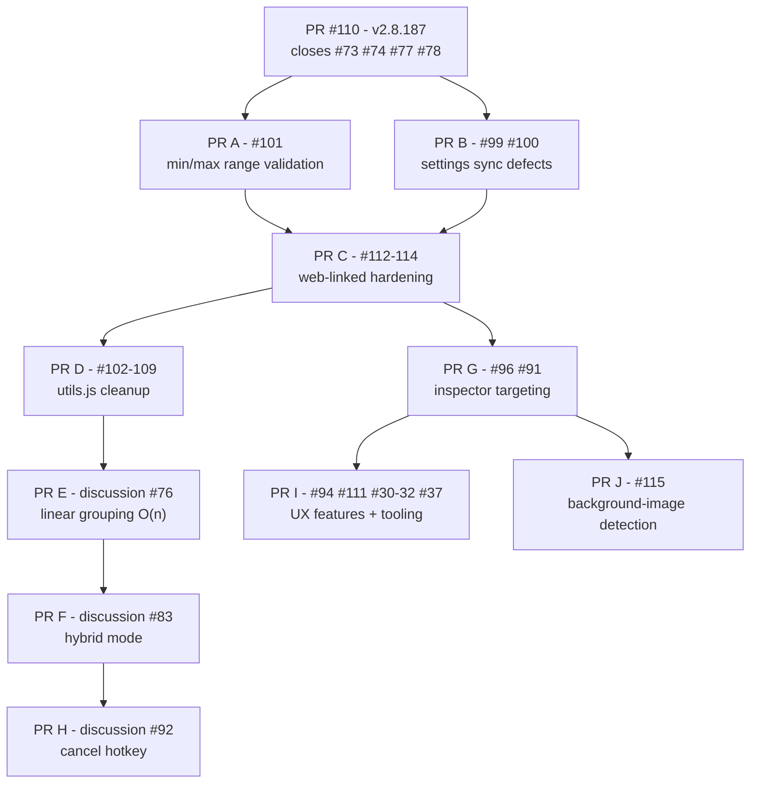

# 🏔️ Mass Image Downloader – Release Roadmap

**Project:** Mass Image Downloader (Chrome MV3, open source, MPL 2.0)</br>
**Repository:** github.com/del-Pacifico/Mass-Image-Downloader</br>
**Maintainer:** Sergio Palma Hidalgo ([@sergiopalmah](https://github.com/sergiopalmah))</br>
**Contributors:** Mr. [@agentsmid](https://github.com/agentsmid)</br>
**Status:** Proposed — pending maintainer approval</br>
**Standards:** This document follows the [Contributing Guide](CONTRIBUTING.md), including the Documentation Standards, Markdown Format, Development Flow, and Labeling Rules sections.</br>
**Last updated:** 2026-10-12

---

## 🧭 1. Purpose

This document is the single source of truth for planned releases. It orders all open
work — from most urgent to least urgent — into versioned release trains, each backed
by one or more pull requests with explicit scope, dependencies, and QA gates.

It complements, and does not replace:

- [CHANGELOG.md](../CHANGELOG.md) — what **shipped**
- [GitHub Issues](https://github.com/del-Pacifico/Mass-Image-Downloader/issues) — what is **tracked**
- [GitHub Discussions](https://github.com/del-Pacifico/Mass-Image-Downloader/discussions) — what is **explored**

### How to read this document

- Each release lists the PRs it ships and the issues/discussions each PR closes.
- Items are ordered by **urgency**, not by estimated effort.
- An item only moves **down** the list through maintainer decision, never sideways.
- Branch naming follows `<type>/<issue>-<slug>` (for example, `fix/101-minmax-range-validation`).
- Commits follow Conventional Commits: `<type>(<scope>): description (#issue)`.
- Every PR must pass local validation before review:

```bash
npm run check
npm test
```

- Manual QA runs on **Brave** (primary), plus Vivaldi, Edge, and Opera One.
- Bugfix PRs are scoped to one confirmed defect class only. Refactors ship separately.

---

## 📋 2. Release overview

| Release | PR(s) | Theme | Closes |
|---|---|---|---|
| **v2.8.187** | PR #110 (existing) | Pending release batch | #73, #74, #77, #78 |
| **v2.8.188** | PR A, PR B | Config & settings hotfixes | #99, #100, #101 |
| **v2.8.189** | PR C, PR D, PR E, PR F | Web-linked Gallery epic | #102–#109, #112–#114, discussions #76, #83, #90 |
| **v2.8.190** | PR G, PR H, PR I, PR J | Inspector targeting, UX features, tooling | #30–#32, #37, #91, #94, #96, #111, #115, discussion #92 |

Housekeeping (label pass, stale discussion closures, announcements) is scheduled in
[Section 7](#🏷️-7-meta--housekeeping) and does not require a code release.

<details>
<summary><strong>Dependency graph (supplementary — same information as the table)</strong></summary>



</details>

---

## 🚢 3. v2.8.187 — Pending release batch

**Source:** existing PR [#110](https://github.com/del-Pacifico/Mass-Image-Downloader/pull/110)
**Status:** QA-approved; awaiting maintainer merge (assigned to @sergiopalmah)

### Closes

| Item | Summary |
|---|---|
| #73 | Web-linked gallery: numeric hotfix for sequential asset naming (`00.html`–`14.html`) |
| #74 | One-click scoring: multi-factor anti-ad penalties |
| #77 | Inspector icon floating after open-in-new-tab |
| #78 | One-click IIFE guard + toast sequence hardening |

### Rationale

This is the operational gate for everything below. The fixes have been QA-approved
since September; the branch is stable, and merging unblocks:

- the anti-ad filter from #74 — a stated **precondition** for the Hybrid mode feature
  (discussion #83);
- the release of v2.8.187, which ships the #77 fix already marked
  `status: ready-for-release` / `status: qa-approved`.

### Post-merge verification (mandatory)

- Re-test the #77 fix on the Inspector flow in Brave.
- Verify **#96** (regression candidate): the spatial fallback introduced by the #77 fix
  must not mount overlays over thumbnails occluded by a site lightbox (ArtStation).

---

## 🚑 4. v2.8.188 — Config & settings hotfixes

Two small PRs, same subsystem (`configCache` / `options`). Shipped together as one
hotfix release because both defect classes are *"the user changes a setting and the
runtime does not reflect it."*

### PR A — `fix/101-minmax-range-validation`

**Closes:** [#101](https://github.com/del-Pacifico/Mass-Image-Downloader/issues/101)

**Why first:** the only open issue labeled `priority: high`. `initConfigCache()` in
`utils.js` parses `minWidth`/`minHeight` with no range validation, and
`isConfigCacheValueUsable()` only checks `> 0`. Corrupted storage values (`NaN`,
`-5`, `999999`) propagate to **every** extraction flow (Bulk, Direct Links, Visual,
Web-Linked, Inspector). The correct pattern already exists in `imageInspector.js`
(range 1–10000 with fallback to defaults) — the fix replicates it in `utils.js`.

**Scope discipline:** ships alone. Minimal diff, clean blame, trivially cherry-pickable.

**QA:** corrupt storage via DevTools (`minWidth: "abc"`, `minHeight: -5`,
`minWidth: 999999`) and confirm fallback to 800×600 across all five flows.

### PR B — `fix/99-100-settings-sync-defects`

**Closes:** [#99](https://github.com/del-Pacifico/Mass-Image-Downloader/issues/99),
[#100](https://github.com/del-Pacifico/Mass-Image-Downloader/issues/100)

**Why second:** same module, same defect class, one review cycle:

- **#99 — High business impact, trivial fix:** `options.js` references
  `document.getElementById("downloadLimit")`, which does not exist in `options.html`.
  The `|| 1` fallback silently nulls download concurrency on every settings save,
  defeating the Performance Presets. For a mass-download extension this degrades the
  core product. Fix: add the missing input bound to the existing `downloadLimit` key.
- **#100:** the `storage.onChanged` listener in `utils.js` does not handle the six
  format flags (`allowJPG`/`allowPNG`/`allowWEBP`/`allowAVIF`/`allowBMP`/`allowGIF`),
  so format toggles take up to 60 s to apply. Fix: add the six branches following the
  pattern already used for other keys.

**QA:** change formats and download limit in Options; confirm immediate effect in a
live extraction without reload; confirm presets actually parallelize.

### Exit criteria for v2.8.188

- PR A and PR B merged into `dev` through the standard review flow, then promoted
  `dev → main` and tagged `v2.8.188` per the release flow.
- `CHANGELOG.md` updated for both user-visible fixes (per the Bugfix Scope Discipline
  requirement).
- Release announcement published (replaces/updates the stale v2.8.186 announcement,
  discussion #80).

---

## 🧗 5. v2.8.189 — Web-linked Gallery epic

The largest gravity well in the backlog: five issues and three discussions all touch
`extractWebLinkedGallery.js` / gallery grouping. Sequenced so each PR leaves the code
cleaner for the next: **behavior hardening → rename → algorithm → feature**.

### PR C — `fix/112-114-web-linked-hardening`

**Closes:** [#112](https://github.com/del-Pacifico/Mass-Image-Downloader/issues/112),
[#113](https://github.com/del-Pacifico/Mass-Image-Downloader/issues/113),
[#114](https://github.com/del-Pacifico/Mass-Image-Downloader/issues/114),
[discussion #90](https://github.com/del-Pacifico/Mass-Image-Downloader/discussions/90) (recorded decision)

**Why third:** the most severe remaining functional defects, all detected in the QA
of PR #110, all in the same flow:

- **#114 (Pexels):** candidate detection accepts `/search/`, `/r/` (affiliate), and
  `/collections/` paths; the dominant group is 5–7 URLs instead of 20+. **Blocks the
  intended download.** Notably, the anti-ad scoring from #74 does **not** catch these
  patterns on v2.8.187 — confirmed in QA.
- **#113 (Unsplash):** profile anchors (`/@user`) are admitted alongside `/photos/`;
  the flow stops **silently** before grouping — no terminal toast, no error. Possible
  unhandled grouper edge with mixed candidates.
- **#112 (Shutterstock):** 15 `/search/...` URLs group at 81.7% similarity and open
  15 irrelevant tabs.

All three demand the same treatment (already sketched in the issues and in discussion
#90):

1. Path-type classification for candidate admission (allow `/photo/`-type segments;
   exclude `/search/`, `/r/`, `/@`, `/collections/`).
2. Defensive terminal toast on every early exit ("no valid candidates grouped").
3. Destination-page validation as a grouping signal where feasible.

Discussion #90 closes with this PR: the architectural decision and the rejected
options (candidate preview, DOM proximity, site hints) are recorded in the PR body.

**Why not rename first (#102):** this PR touches candidate admission and terminal
states, not the internals of `calculatePathSimilarity`. Renaming after behavior is
stabilized (PR D) keeps the refactor blame clean.

**QA:** Pexels/Unsplash/Shutterstock gallery, search, and category pages on all four
QA-baseline browsers; confirm correct grouping, correct tab set, and terminal toasts
on failure.

### PR D — `chore/102-109-utils-cleanup`

**Closes:** [#102](https://github.com/del-Pacifico/Mass-Image-Downloader/issues/102)–[#109](https://github.com/del-Pacifico/Mass-Image-Downloader/issues/109)

Single cleanup PR for all low-priority `utils.js` debt, formally deferred by PR #110
to "a future PR" and already suggested for grouping by the issues themselves:

- **#102** — rename the two divergent `calculatePathSimilarity` implementations
  (Option A: minimal disambiguation). **Prerequisite for PR E.**
- **#103** — remove unnecessary `async` from pure predicates.
- **#104** — initialize `downloadFolder` / `customFolderPath` in the configCache literal.
- **#105** — sanitize illegal filesystem characters in `buildDownloadPath` (latent bug).
- **#106 / #107** — remove dead code (`moveToNextTab`, `isValidRelativeFolder`).
- **#108** — cap the `closedTabs` set (MV3 hygiene).
- **#109** — unify `sanitizeFilenameComponent` export style.

**Why fourth:** debt concentrated in one file, near-zero risk, fully covered by
`npm test`; unblocks PR E with a clean base.

### PR E — `perf/76-linear-grouping`

**Implements:** [discussion #76](https://github.com/del-Pacifico/Mass-Image-Downloader/discussions/76)
**Labels:** `type: performance` + `scope: galleries` + `priority: medium` (per Labeling Rules)

Background gallery grouping is O(n²): 1.12M comparisons and over 2 minutes of CPU on
a 1,500-image gallery. The discussion ships a validated design: configurable
`gallerySmartGroupingMaxImages` threshold plus linear prefix grouping (O(n)), with an
informative toast. Requires #102 (rename) done first to keep the algorithm change
blame clean.

### PR F — `feat/83-hybrid-mode`

**Implements:** [discussion #83](https://github.com/del-Pacifico/Mass-Image-Downloader/discussions/83)

Opt-in hybrid mode that detects image-wrapper pages (ImageTwist, imgbox-class hosts)
and injects the correct One-click icon. The design is consensus-ready (detection
counters + three injection priorities) and was blocked on #74 — unblocked by v2.8.187.
Ships last in the epic because it touches the same two files hardened in PR C and
renamed in PR D.

### Exit criteria for v2.8.189

- PR C–F merged into `dev`, promoted `dev → main`, tagged `v2.8.189`.
- `CHANGELOG.md` updated for the user-visible fixes (#112–#114) and new features.
- Discussion #90 closed with the architectural decision recorded.
- Epic summary posted to the discussion #83 and #76 comment threads.

---

## 🔍 6. v2.8.190 — Inspector targeting, UX features, tooling

### PR G — `fix/96-91-inspector-targeting`

**Closes:** [#96](https://github.com/del-Pacifico/Mass-Image-Downloader/issues/96),
[#91](https://github.com/del-Pacifico/Mass-Image-Downloader/issues/91)
**Triage only (no fix):** [#95](https://github.com/del-Pacifico/Mass-Image-Downloader/issues/95),
[#97](https://github.com/del-Pacifico/Mass-Image-Downloader/issues/97)

**Why:** #96 is a **confirmed regression** of the #77 fix — the spatial fallback
mounts overlays over thumbnails occluded by a site lightbox (ArtStation). Regressions
always jump the queue. The proposed fix (occlusion check via `elementFromPoint`) is
small and scoped. #91 shares the targeting phase: the One-click scoring must verify
visibility (`getBoundingClientRect`, carousel active-slide class) before anchoring.
Same file family (`injectSaveIcon.js`), same fix family — different flow from PR C.

#95 (lazy-loaded + CDN-parameterized thumbnails) and #97 (Behance) receive only
documented triage (hypotheses H1–H4 for #97) in this PR, respecting one-confirmed-
defect-per-PR discipline.

### PR H — `feat/92-cancel-hotkey`

**Implements:** [discussion #92](https://github.com/del-Pacifico/Mass-Image-Downloader/discussions/92)

Mature feature proposal: `Shift+Alt+C` cancels in-progress flows. The hard analysis
is already done (MV3's 4-command limit forces a page-side `keydown` handler; message
contract and the 8-file documentation matrix are specified). Ships here — not earlier —
because the `activeFlow` flag lands best on the orchestration cleaned up by PR C–F,
and it is the cross-cutting mitigation for flows that open dozens of tabs
(discussions #90, #91). Hotkey documentation updates land in `docs/hotkeys/hotkeys.md`,
per the project's documentation rules.

### PR I — `feat/94-toast-position`, `chore/111-conflict-markers`, `fix/30-32-overlay-geometry`, `feat/37-context-menu`

Four small items, one release:

- **#94 — Configurable toast position (four corners).** UX mitigation for #93; default
  top-right changes nothing for existing users. Stays inside the project palette.
- **#111 — Conflict-marker detection in `npm run check`.** Born from a real merge
  conflict that survived QA into `docs/README.md` during PR #110. Sub-second tooling.
- **#30 / #31 / #32 — Overlay geometry.** The three `InspectorOverlayOffset` sub-issues
  of #21 share one fix: rect selection + viewport clamping. Visual-only impact.
- **#37 — Context menu MVP.** Implementation of discussion #36. **Precondition:**
  consolidate the three duplicate entry-point discussions (#36, #70, #81) into #36
  before coding; #37 carries `needs: design`.

### PR J — `fix/115-background-image-detection`

**Closes:** [#115](https://github.com/del-Pacifico/Mass-Image-Downloader/issues/115)

**Why:** X (Twitter) renders tweet images using CSS `background-image` on `<div>` elements instead of standard `` tags. The current `injectSaveIcon.js` candidate detection loop only searches for ``, `<picture>`, and `<source>` DOM elements. As a result, the One-click icon fails to inject on tweet pages opened by Web-linked Galleries, showing the error toast "MID: No valid images found on this page."

**Scope:** Expand the candidate detection loop in `injectSaveIcon.js` to parse `element.style.backgroundImage` and `getComputedStyle(element).backgroundImage` for elements with `background-image` CSS. Extract URLs via regex, validate against allowed formats and minimum dimensions, and admit them as valid candidates.

**Why not in PR G:** PR G addresses targeting/visibility defects (#96 occlusion, #91 carousel active-slide). Issue #115 is a candidate *detection* defect — the icon never finds a candidate to target. Different defect class, per the one-confirmed-defect-class-per-PR rule.

**Performance consideration:** Parsing computed styles on all DOM nodes is expensive. The scan should be restricted to large visible nodes or specific structural wrappers to maintain the Minimal Technical Footprint.

**QA:** X (Twitter) tweet pages opened via Web-linked Galleries on Brave + Edge + Opera One. Confirm icon appears, downloads correct image, and no regression on standard `` pages.

### Exit criteria for v2.8.190

- PR G–I merged into `dev`, promoted `dev → main`, tagged `v2.8.190`.
- `CHANGELOG.md` updated; `docs/hotkeys/hotkeys.md` updated for the cancel hotkey.
- Discussion #92 closed as implemented.
- Discussions #36/#70/#81 consolidated and closed.

---

## 🏷️ 7. Meta & housekeeping

No code release required. Scheduled after v2.8.188 lands.

1. **Label pass** (per Labeling Rules): promote #113 and #114 to `priority: high`
   (functional failure / silent stop — impact exceeds their current `normal` +
   `needs: triage`); align the `type:` label of #114 (title says `[Bug]`, label says
   `edge-case`); ensure every promoted issue carries `type:*` + `scope:*` +
   `priority:*` + `status:*` before planning.
2. **Release labels:** release PRs and tags carry `type: release` + `scope: release`
   plus the appropriate release status label.
3. **Close stale discussions:** #28, #29 (documentation announcements), #33, #34, #35
   (governance of labels/issue system — historical), #80 (release announcement,
   superseded by each new release).
4. **Cold backlog review:** #38 (i18n) and #75 (Ethical Hacking Framework) — keep as
   backlog or close if no traction within one to two release cycles.

---

## 🧭 8. Guiding principles of this roadmap

1. **Urgency over effort.** High-priority and regression items always precede backlog.
2. **Each PR leaves the base cleaner than it found it** — hotfix → behavior hardening
   → rename → algorithm → feature. Never refactor over freshly changed behavior.
3. **One confirmed defect class per bugfix PR.** Triage and hypotheses are documented,
   not mixed into fixes.
4. **Discussions close with decisions.** When a discussion's problem is promoted to
   issues (#90 → #112–#114), the discussion closes with the architectural decision
   recorded instead of lingering as a zombie.
5. **Releases are small and frequent.** Four releases over the epic instead of one
   monolith keeps `main` releasable at every step, following the
   `feature/chore/fix branch → dev → main → tag/release` flow.

---

## 📝 9. Roadmap change log

| Date | Change |
|---|---|
| 2026-10-12 | Initial proposal: release trains v2.8.187–v2.8.190 derived from the 26 open issues and 17 open discussions audit. |
| 2026-10-12 | Revised to full Contributing Guide compliance: project-name-first H1, emoji headers only, language-tagged code blocks, corrected `dev → main → tag` release flow, CHANGELOG exit criteria, label rules, collapsible dependency graph. |
| 2026-10-13 | Added Issue #115 (One-click icon fails on X/Twitter due to CSS `background-image` rendering) to v2.8.190 as PR J. Discovered during QA of PR #110, Social site category. |
